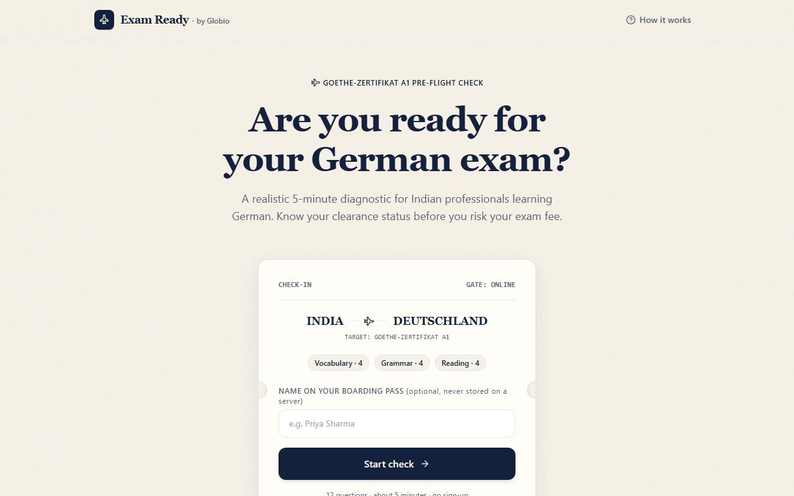
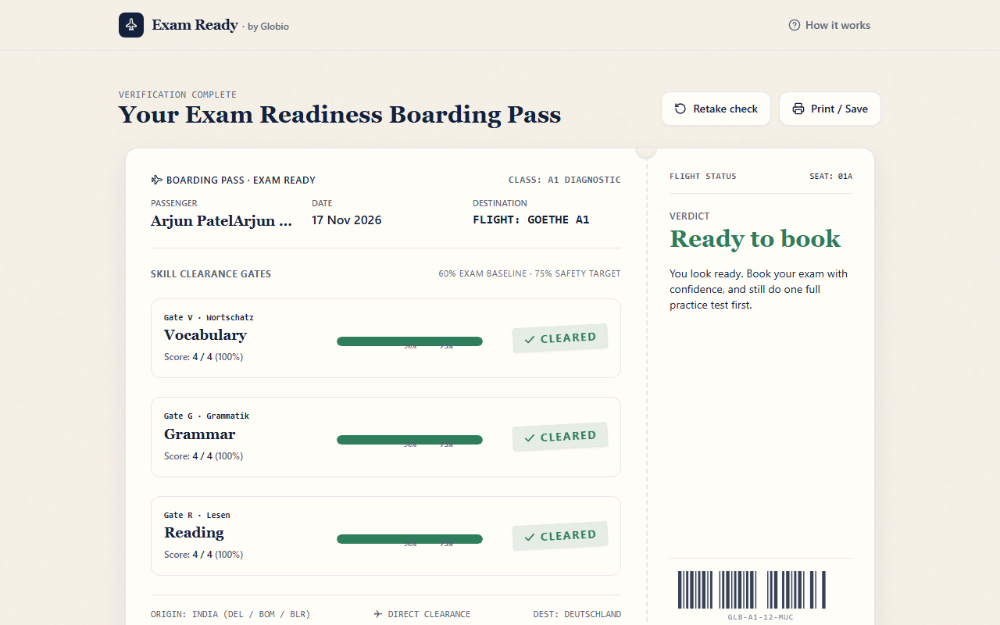
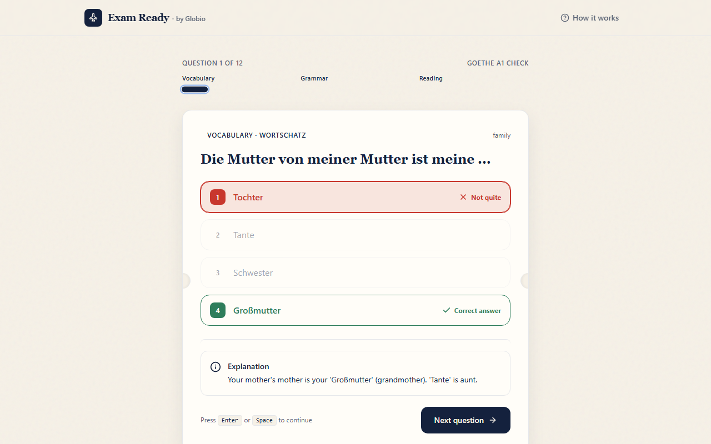
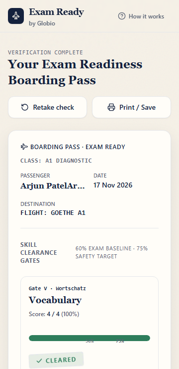

# Exam Ready · Goethe A1 Readiness Check

> A calm, trustworthy, and precise diagnostic web app for Indian professionals preparing to take the **Goethe-Zertifikat A1 (Start Deutsch 1)** exam. Built for **Globio**.

---

## 🛫 The Problem
Learners frequently complete their A1 German preparation and book the official Goethe-Zertifikat A1 exam without knowing if they are truly ready. When a module is failed, candidates forfeit their non-refundable exam fee (often ₹10,000–₹12,000+ in India) and lose critical weeks in their immigration or job relocation timeline.

**Exam Ready** answers one decisive question with clarity and safety:  
**"Am I exam-ready?"**

---

## 🎯 How Readiness Is Calculated

### 1. Real Exam Anchor & Safety Margin
The official Goethe-Zertifikat A1 exam requires a **60%** score to pass each individual module. Because Exam Ready is a focused 12-question diagnostic check rather than a 90-minute examination, a **statistical safety margin** is applied to protect learners from borderline false positives:

| Skill Score | Clearance Status | Stamp Badge | Meaning |
| :--- | :--- | :--- | :--- |
| **≥ 75%** | **Ready (Cleared)** | `CLEARED` (Green) | Solid foundational confidence |
| **50% – 74%** | **Borderline** | `BORDERLINE` (Amber) | High risk of failing under exam conditions |
| **< 50%** | **Not Yet** | `NOT YET` (Red) | Significant gaps in core topics |

---

### 2. The Weakest-Skill Principle
Exam Ready evaluates readiness using the **weakest skill**, not the mathematical average. 

In the official Goethe exam, excellence in vocabulary cannot compensate for failing reading comprehension. Therefore:
- **"Ready to book"**: Every single skill achieves `Ready` (≥ 75%).
  > *"You look ready. Book your exam with confidence, and still do one full practice test first."*
- **"Almost there"**: No skill is `Not yet`, but at least one skill is `Borderline` (50–74%).
  > *"You are close. Practise the topics below, then retake this check before booking."*
- **"Not yet"**: At least one skill falls into `Not yet` (< 50%).
  > *"Wait a little before booking. Practise the topics below to protect your exam fee."*

---

### 3. Practice Recommendation Algorithm
When mistakes occur, topics are ranked by:
1. **Mistake count** (highest frequency first).
2. **Lowest-scoring skill** as tie-breaker (mistakes in weak modules are prioritized).
3. The top 2–3 actionable practice tips are mapped and rendered.
4. If 0 mistakes occur: *"Take a full official practice exam before booking."*

All thresholds and verdict copy are centralized in `src/lib/scoring.js`.

---

## 🎨 Design System: "Passport & Boarding Pass"

Designed with an international transit theme—calm, warm, confident, and professional:
- **Design Tokens:**
  - **Paper background:** `#F6F1E7` with subtle SVG paper grain texture (`feTurbulence` at 4.5% opacity).
  - **Surface cards:** `#FFFDF8`.
  - **Typography:** *Fraunces* (warm modern serif for headlines) + *Inter* (clear sans-serif for body).
  - **Stamp palette:** Clearance Green (`#2E7D5B`), Caution Amber (`#B97500`), Stop Red (`#C8372D`).
  - **Boarding Pass Hero:** Authentic perforated ticket layout with semicircle notches, gate breakdown bars, animated rubber stamps, and deterministic SVG barcode.
- **Microcopy:** Plain English, supportive and clear, tailored for international learners.
- **Accessibility (WCAG AA):**
  - Full keyboard control (keys `1`–`4` for options, `Enter` / `Space` to advance).
  - High contrast ratios (all text ≥ 4.5:1 on paper background).
  - Screen reader friendly (`aria-live="polite"`, `role="radiogroup"`, `role="progressbar"`, focus trapping).
  - `lang="de"` applied to German question stems and passages.
  - Supports `prefers-reduced-motion`.

---

## 📸 Screenshots

| Landing Page (Desktop) | Boarding Pass (Desktop) |
| :---: | :---: |
|  |  |

| Quiz Interface (Mobile & Desktop) | Mobile Stacking & Perforations |
| :---: | :---: |
|  |  |

*(Additional screenshots available in [`docs/screenshots/`](docs/screenshots/))*

---

## 🖨️ Print / Save Stylesheet
The dedicated print stylesheet hides headers, buttons, footers, and modals, printing **only** the Boarding Pass and practice plan in clean high-contrast black-and-white.

---

## 🛠️ Tech Stack & Architecture
- **Framework:** React 18 + Vite
- **Styling:** Tailwind CSS + CSS Custom Properties
- **Icons:** `lucide-react`
- **Testing:** Vitest (unit tests for scoring logic, questions bank, and shuffle engine)
- **State Management:** React state + resilient `localStorage` caching (graceful fallback)
- **Zero Backend:** Runs 100% client-side with zero external analytics or database dependencies.

### Directory Structure
```
ready-for-goethe/
├── .github/workflows/deploy.yml   # Automated GitHub Pages CI/CD
├── docs/screenshots/              # Verification screenshots
├── public/
│   └── favicon.svg                # Vector airplane brand favicon
├── src/
│   ├── components/
│   │   ├── Barcode.jsx            # Deterministic SVG barcode
│   │   ├── BoardingPass.jsx       # Boarding pass hero component
│   │   ├── Footer.jsx             # Disclaimer & Globio attribution
│   │   ├── Header.jsx             # Brand wordmark, "How it works"
│   │   ├── HowItWorksModal.jsx    # Accessible modal with focus trap
│   │   ├── NoticePanel.jsx        # German reading passage container
│   │   ├── PracticeRecommendations.jsx
│   │   ├── ProgressBar.jsx        # 12-tick segmented progress bar
│   │   ├── QuestionCard.jsx       # Ticket question with 1-4 keys
│   │   └── StampBadge.jsx         # Animated rubber stamp badges
│   ├── data/
│   │   ├── questions.js           # Question bank & practice tips
│   │   └── questions.test.js      # Data integrity unit tests
│   ├── lib/
│   │   ├── scoring.js             # Pure readiness & gate calculations
│   │   ├── scoring.test.js        # Vitest scoring test suite
│   │   ├── shuffle.js             # Runtime shuffle utilities
│   │   ├── shuffle.test.js        # Shuffle verification tests
│   │   └── storage.js             # Safe localStorage handler
│   ├── pages/
│   │   ├── LandingPage.jsx        # Check-in landing page
│   │   ├── QuizPage.jsx           # Quiz runner & feedback flow
│   │   └── ResultPage.jsx         # Boarding pass result view
│   ├── App.jsx                    # Root app state machine
│   ├── index.css                  # Design tokens, grain, print styles
│   └── main.jsx
├── index.html
├── package.json
├── tailwind.config.js
├── vite.config.js
└── vitest.config.js
```

---

## 🧪 Testing

Run the automated test suite with Vitest:
```bash
npm test
```
The suite verifies:
- Exactly 12 questions (4 per skill) with valid answers, passages, and explanations.
- Boundary conditions (50% and 75%).
- Weakest-skill dominance (high average with one weak module correctly results in *Not yet*).
- Practice tip ranking and tie-breaking by lowest-scoring skill.
- Shuffling logic and option text tracking.

---

## 🚀 Running Locally & Deploying

### Local Development
```bash
npm install
npm run dev
```
Open [http://localhost:5173/](http://localhost:5173/) in your browser.

### Production Build
```bash
npm run build
```

### Deployment Configuration
The Vite base path defaults to `/exam-ready-german/` for production builds (for GitHub Pages hosting) and `/` for local development. You can easily override it for any platform (such as Vercel or custom domain) using the `VITE_BASE_PATH` environment variable:
```bash
# For custom domain / root path (e.g. Vercel)
VITE_BASE_PATH="/" npm run build

# For GitHub Pages subpath
VITE_BASE_PATH="/exam-ready-german/" npm run build
```

---

## ⚠️ Current Limitations (v1)
- **Skill Coverage:** Diagnoses Vocabulary, Grammar, and Reading. Does not test Hören (Listening), Schreiben (Writing), or Sprechen (Speaking), which represent the remaining 50% of the Goethe A1 score.
- **Diagnostic Sample Size:** 12 questions provide an estimate with a safety margin, but cannot replace a full 60-to-90 minute mock exam.

---

## 🔮 What to Measure & Build in v2
1. **Metrics to Track:**
   - Funnel completion rate (Landing → Question 12 → Boarding Pass).
   - Topic failure distribution (identifying which A1 grammar topics are hardest for Indian candidates).
   - "Retake" rate and readiness delta between attempts.
2. **V2 Roadmap:**
   - **Audio Section (Hören):** Native speaker audio snippets for train station announcements and voicemail messages.
   - **Form-filling drill (Schreiben):** Interactive practice for the Goethe landing card / hotel registration form question.
   - **Target Exam Date countdown:** Integration with Goethe-Institut booking deadlines across Max Mueller Bhavan centres (Delhi, Mumbai, Bengaluru, Chennai, Pune, Kolkata).
   - **Downloadable PDF Boarding Pass:** Serverless PDF generation in addition to native browser print.

---

## ⚖️ Legal & Disclaimer
*Exam Ready is an independent preparation tool created by Globio. It is not affiliated with, approved by, or endorsed by the Goethe-Institut.*
